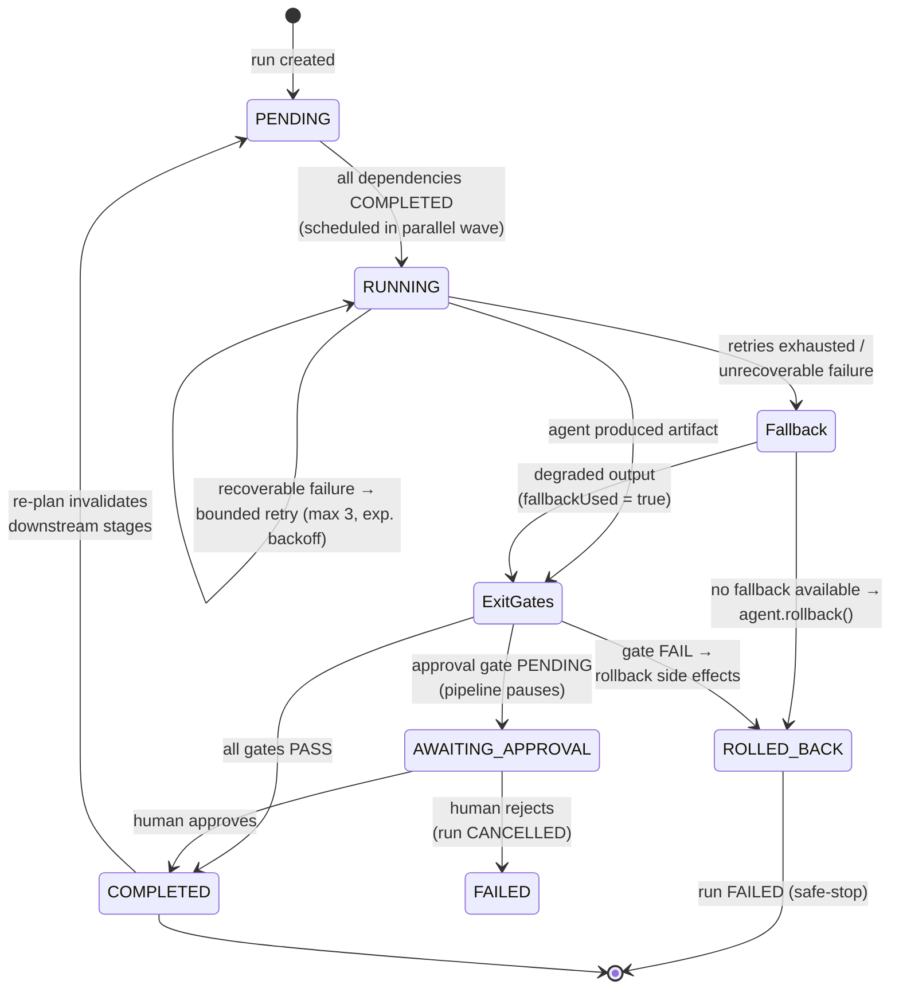
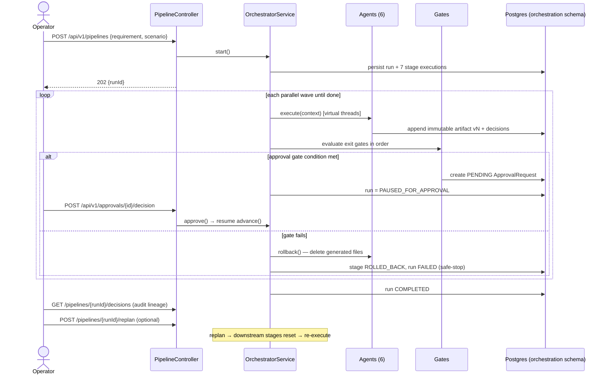

# 12 — Orchestration Flow Diagrams (as implemented)

Visual reference for the implemented `agentic-orchestration-service`. The graph below is
rendered from [pipeline-definition.yml](../agentic-orchestration-service/src/main/resources/pipeline-definition.yml) —
the DAG is data, not code.

## 1. SDLC Pipeline DAG (stages, gates, approvals)

```mermaid
flowchart TD
    START([POST /api/v1/pipelines<br/>requirementText + scenarioType]) --> REQ

    subgraph REQ_STAGE[Stage: requirements]
        REQ[RequirementAgent<br/>intent, ambiguities, acceptance criteria]
        REQ --> G1{{schema:requirement-spec}}
        G1 --> G2{{policy}}
        G2 --> A1{approval:clarification<br/>only if BLOCKER ambiguities}
    end

    A1 -- "PENDING → pipeline pauses" --> HUMAN1[/Human clarifies via<br/>POST /approvals/id/decision/]
    HUMAN1 --> DES
    A1 -- "not required / approved" --> DES

    subgraph DES_STAGE[Stage: design]
        DES[DesignAgent<br/>components, OpenAPI, ADRs,<br/>brownfield impact analysis]
        DES --> G3{{schema:design-spec}}
        G3 --> G4{{openapi}}
        G4 --> G5{{policy}}
        G5 --> A2{approval:schema-migration<br/>only if schemaChanges}
    end

    A2 -- "PENDING → pipeline pauses" --> HUMAN2[/Human approves DB change/]
    HUMAN2 --> FORK
    A2 -- "not required / approved" --> FORK

    FORK((parallel fork))

    subgraph DOCS_BRANCH[Parallel branch]
        DDOC[DocumentationAgent<br/>DESIGN.md]
        DDOC --> G6{{policy}}
    end

    subgraph IMPL_BRANCH[Main branch]
        IMPL[ImplementationAgent<br/>sandboxed codegen + migrations]
        IMPL --> G7{{build}}
        G7 --> G8{{policy}}
        G8 --> TEST[TestAgent<br/>generates tests + test-report]
        TEST --> G9{{"test (0 failed, cov ≥ 80%)"}}
        G9 --> G10{{policy}}
        G10 --> REV[ReviewAgent<br/>security / TODO / reflection review]
        REV --> G11{{schema:review-report}}
        G11 --> G12{{policy}}
        G12 --> A3{approval:major-findings<br/>only if unresolved MAJOR}
    end

    FORK --> DDOC
    FORK --> IMPL
    A3 -- "PENDING → pipeline pauses" --> HUMAN3[/Human accepts or rejects findings/]

    G6 --> JOIN((sync point))
    A3 -- "not required / approved" --> JOIN
    HUMAN3 --> JOIN

    subgraph FINAL_STAGE[Stage: release-readiness]
        JOIN --> FDOC[DocumentationAgent<br/>RUN-SUMMARY.md: plan, artifacts,<br/>risks, lineage, reliability stats]
        FDOC --> G13{{policy}}
    end

    G13 --> DONE([Pipeline COMPLETED<br/>outputs in runs/runId/])

    style HUMAN1 fill:#fff3cd,stroke:#b8860b
    style HUMAN2 fill:#fff3cd,stroke:#b8860b
    style HUMAN3 fill:#fff3cd,stroke:#b8860b
    style DONE fill:#d4edda,stroke:#2e7d32
```

## 2. Stage execution lifecycle (retry / fallback / rollback)

## 3. Run-level control flow (API interactions)

## 4. Where things live at runtime

| Output | Location |
|---|---|
| Generated code, tests, docs | `runs/{runId}/{stage}/...` (sandboxed workspace) |
| Final summary | `runs/{runId}/release-readiness/RUN-SUMMARY.md` |
| Artifacts (versioned JSON) | `GET /api/v1/pipelines/{runId}/context` |
| Decision lineage | `GET /api/v1/pipelines/{runId}/decisions` |
| Pipeline/stage state | `orchestration` schema in PostgreSQL |
